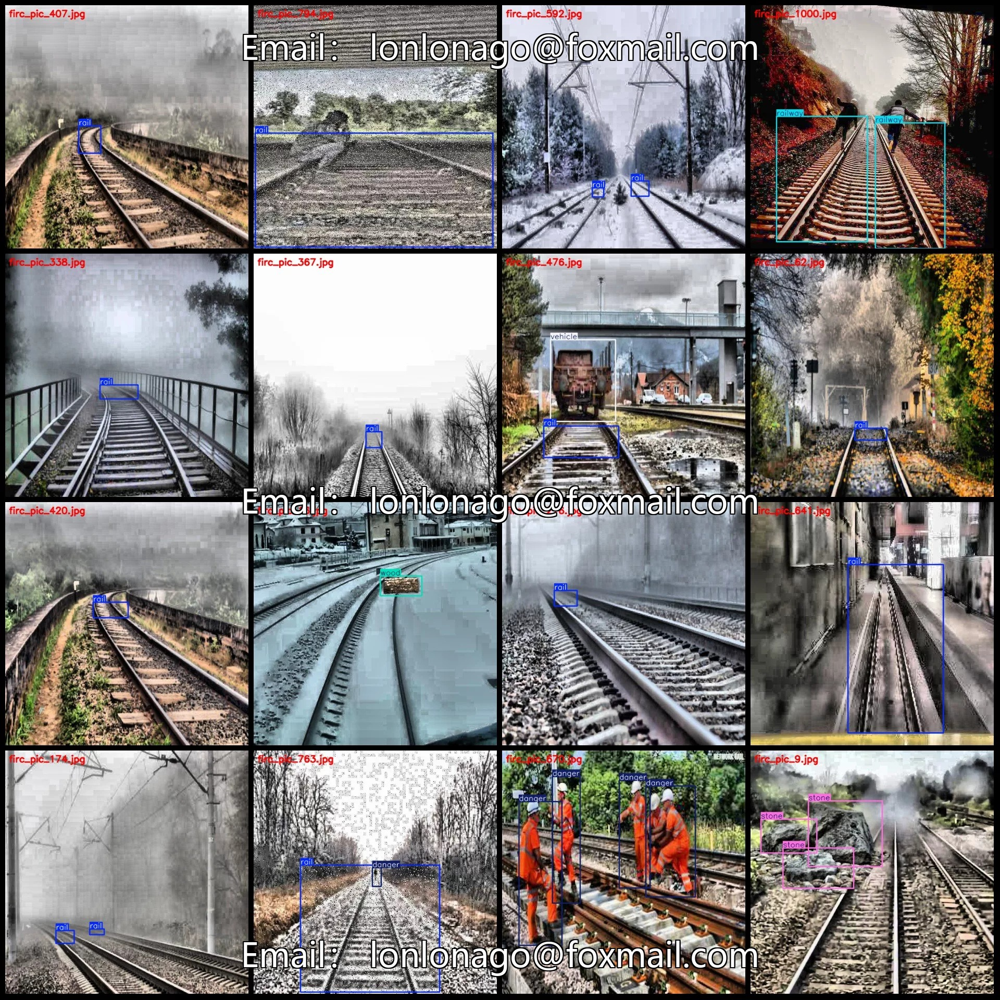
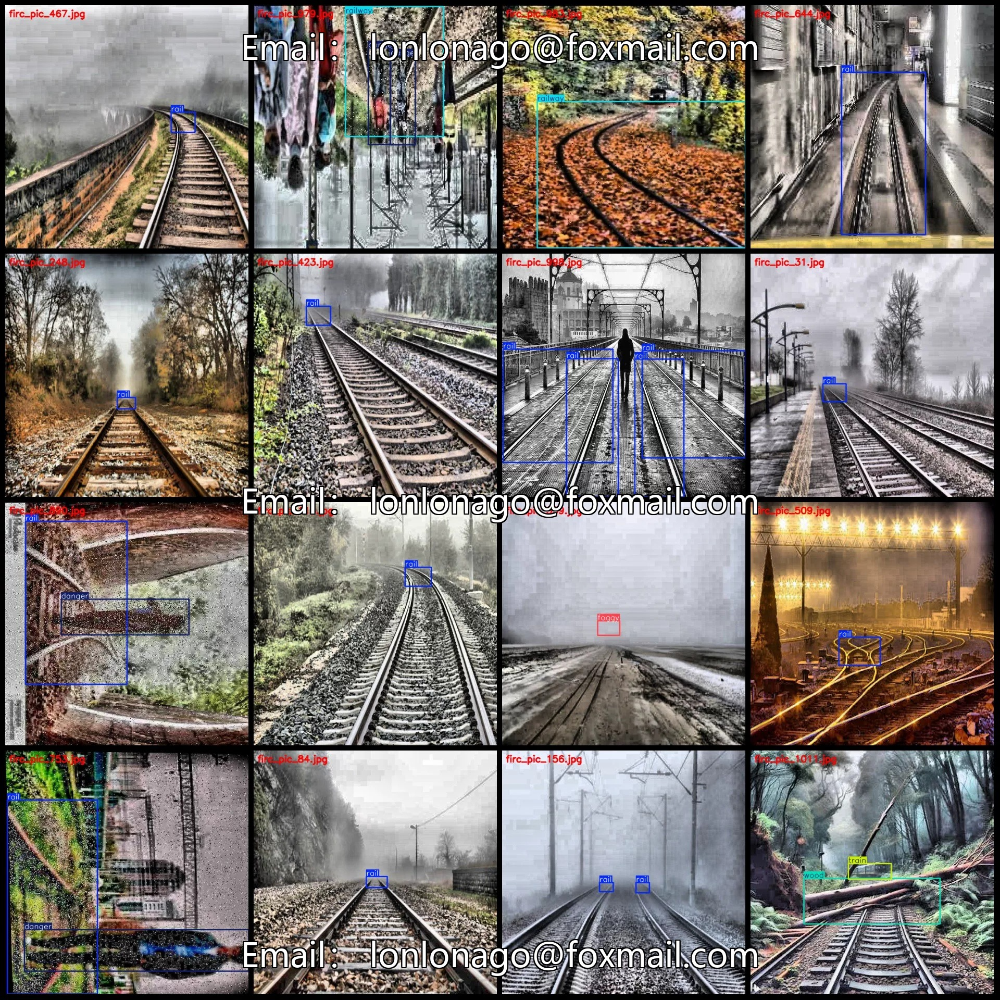
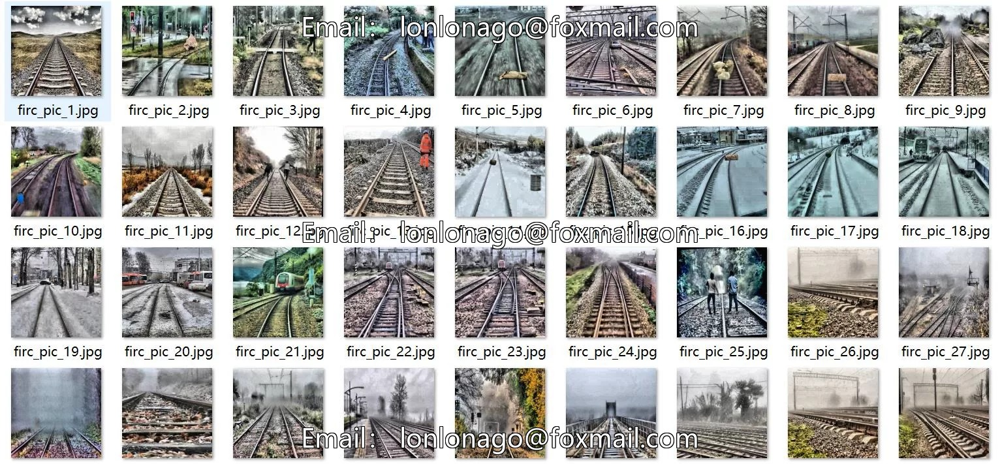
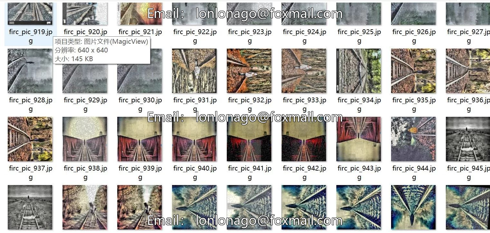

# Intelligent Railway Extreme Weather Tracking Objects Intrusion Railway Junk Detection Dataset VOC+YO

## Body

Smart Railway Extreme Weather Impact Track Object Detection Data Set - VOC+YOLO Format: 1017 Images, 13 Categories
Warm Reminder: Due to the dataset's replicability, please confirm compliance with requirements before purchasing.
Note: The dataset contains some enhanced images, approximately 700 of which are original images, while the rest are enhanced images.
Dataset Format: Pascal VOC format + YOLO format (txt file without split paths, only containing jpg images and corresponding VOC format xml files and yolo format txt files)
Number of Images (Total jpg files): 1017
Number of Annotations (Total xml files): 1017
Number of Annotations (Total txt files): 1017

Annotation Category Count: 13
Annotation Category Names (Note that the order of categories in the yolo format does not correspond to this, but is based on the labels folder's classes.txt): ["animal", "bucket", "danger", "foggy", "grass", "motorbike", "person", "rail", "railway", "stone", "train", "vehicle", "wood"]
Number of Boxes per Category
animal (Animal) Number of boxes = 10
bucket (Bucket) Number of boxes = 4
danger (Danger) Number of boxes = 343

Foggy (Mist) Frames = 18
Grass (Grass) Frames = 2
Motorbike (Motorcycle) Frames = 1
Person (Person) Frames = 106
Rail (Rail) Frames = 1172
Railway (Railway) Frames = 36
Stone (Stone) Frames = 13
Train (Train) Frames = 92
Vehicle (Vehicle) Frames = 88
Wood (Wood) Frames = 13
Total Frames: 1898
Number of Images per Category
Animal (Animal) Number of Images = 4
Bucket (Bucket) Number of Images = 2

Danger (Hazard) Ownership of images = 179
foggy (mist) occupies = 18
Grass (Herbage) occupies = 2
motorbike (motorcycle) occupies = 1
Person (person) occupies the image count = 30
Rail (railway) occupies a picture count = 900
Railway (Rail) occupies 29 images.
stone (stone) occupies picture count = 11
Train (train) occupies a picture count = 61
vehicle (vehicle) occupancy count = 58
Wood (Timber) occupies 13 images.

Image resolution: 640x640
Using labeling tool: labelImg
Labeling rules: Draw a rectangle around the category.
Important note: The dataset does not have separate training, validation, and test sets; you need to partition them yourself.
Special declaration: This dataset does not guarantee the accuracy of the trained models or weight files.

## Images

## Payment

Here is a pay link on Stripe ( https://buy.stripe.com/3cs8yP7sY87d0vu9AB ). Please contact me lonlonago@foxmail.com after funding $89, and I will send you a complete data files , thank you!

